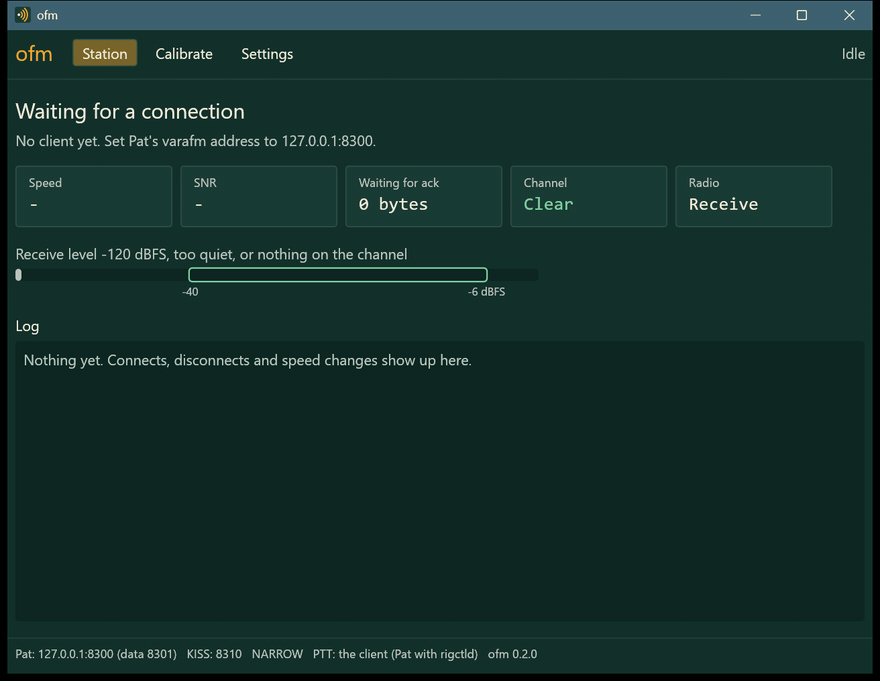
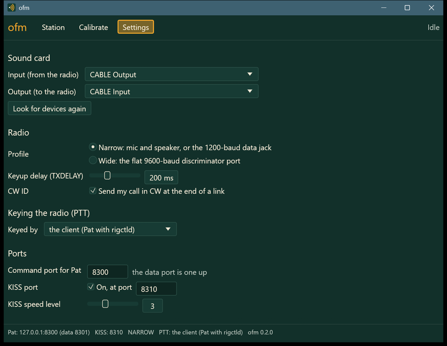

<p align="center">
  
</p>

<h1 align="center">ofm</h1>

<p align="center">
  <b>An open source sound card modem for FM radios that Pat can use in place of VARA FM.</b>
</p>

<p align="center">
  <a href="https://github.com/Londopy/ofm/actions/workflows/ci.yml"></a>
  <a href="https://github.com/Londopy/ofm/actions/workflows/release.yml"></a>
  <a href="https://github.com/Londopy/ofm/releases/latest"></a>
  <a href="https://github.com/Londopy/ofm/releases/latest"></a>
  <a href="CHANGELOG.md"></a>
  <br>
  <a href="https://github.com/Londopy/ofm/releases"></a>
  <a href="#install"></a>
  <a href="#install"></a>
  <a href="https://github.com/Londopy/ofm"></a>
  <a href="#use-it-with-pat"></a>
  <a href="#license"></a>
</p>

<p align="center">
  <a href="#install">Install</a> ·
  <a href="#use-it-with-pat">Use it with Pat</a> ·
  <a href="#try-it-without-radios">Try it without radios</a> ·
  <a href="#commands">Commands</a> ·
  <a href="docs/waveform.md">Waveform</a> ·
  <a href="CHANGELOG.md">Changelog</a>
</p>

<p align="center">
  
  <br>
  <sub>A real two-way 26 KB transfer between two ofm modems over a virtual audio cable, sped up 2x. Test callsigns, no radios.</sub>
</p>

ofm is a modem for VHF/UHF FM radios. 📻 Toward Winlink clients it looks like VARA FM: the
same two TCP ports and the same text commands, so Pat connects to it as `varafm://` with no
changes on Pat's side. On the air it uses its own open OFDM waveform, so an ofm station talks
only to other ofm stations.

| | |
|---|---|
| **Host interface** | VARA FM compatible: commands on TCP 8300, data on 8301, plus KISS over TCP on 8310 |
| **Waveform** | Open OFDM with 802.11n LDPC and ARQ, documented in full in [docs/waveform.md](docs/waveform.md) |
| **Speed** | Ten levels, adapting to the link; 6.0 kbps (Narrow) and 12.0 kbps (Wide) measured over a virtual cable |
| **Keying** | Pat with rigctld, VOX, or ofm itself through serial RTS/DTR, a CM108 GPIO or rigctld |
| **Ways to run it** | A window (`ofm gui`), a terminal (`ofm run`), or `ofm sim` with no radio at all |

> [!WARNING]
> ofm is early work and **has not been tested on the air yet**. It has been tested in a channel
> simulator, between two instances over a virtual audio cable, and with real Pat (1.0.1) holding
> Winlink P2P sessions in both directions through [`ofm sim`](#try-it-without-radios). The
> waveform format is not frozen yet, so run the same ofm version at both ends of a link.

## Quick start

```powershell
scoop bucket add londopy https://github.com/Londopy/scoop-bucket
scoop install londopy/ofm
ofm gui
```

Pick your radio interface's sound card under **Settings**, set your deviation under
**Calibrate**, then point Pat's `varafm` address at `127.0.0.1:8300`. The [Pat section](#use-it-with-pat)
walks through it step by step.

## Install

### Windows

Every [release](https://github.com/Londopy/ofm/releases/latest) has the same set of downloads:

| Download | What it is |
|---|---|
| `ofm-<version>-setup-x64.exe` | Installer (recommended). Per-user, no admin prompt, and puts `ofm` on your PATH. |
| `ofm-<version>-x64.msi` (also `x86`, `arm64`) | MSI installer. Per-user by default; IT can deploy it machine-wide. |
| `ofm-v<version>-x64-portable.exe` (also `x86`, `arm64`) | The exe on its own, nothing to install. |
| `ofm-v<version>-portable.zip` | All three builds in one zip; settings stay next to the exe. |
| `install.ps1` / `install.cmd` | Script install that picks the right build and checks its SHA-256. |
| `<file>.torrent` and magnet links | Any of the above over BitTorrent, with GitHub as the web seed when nobody is seeding. |

PowerShell one-liner:

```powershell
irm https://github.com/Londopy/ofm/releases/latest/download/install.ps1 | iex
```

Scoop:

```powershell
scoop bucket add londopy https://github.com/Londopy/scoop-bucket
scoop install londopy/ofm
```

The Start menu and desktop shortcuts open the [ofm window](#the-ofm-window). From a terminal,
`ofm run` starts the modem without it.

<details>
<summary>Script options and machine-wide MSI installs</summary>

`install.ps1` takes `-Msi`, `-Portable` (add `-AddToPath` to put it on PATH), `-AllUsers` and
`-Version 1.2.3`. To pass them, run the script as a block:

```powershell
& ([scriptblock]::Create((irm https://github.com/Londopy/ofm/releases/latest/download/install.ps1))) -Portable -AddToPath
```

MSI for every user (admin): `msiexec /i ofm-<version>-x64.msi ALLUSERS=2 MSIINSTALLPERUSER=""`.
Add `DESKTOPSHORTCUT=0` to skip the desktop shortcut or `ADDTOPATH=0` to leave PATH alone.

</details>

### Linux

Each release has `ofm-v<version>-linux-x64.tar.gz` for x86_64 with glibc 2.35 or newer
(Ubuntu 22.04, Debian 12 and later):

```sh
tar -xzf ofm-v<version>-linux-x64.tar.gz
install -Dm755 ofm-v<version>-linux-x64/ofm ~/.local/bin/ofm
```

### Checking a download

The binaries are not code-signed, so Windows SmartScreen may warn the first time you run one
(**More info**, then **Run anyway**). Every release ships `SHA256SUMS.txt`; compare a download
with its line there:

```powershell
(Get-FileHash .\<file> -Algorithm SHA256).Hash.ToLower()
```

On Linux: `sha256sum -c SHA256SUMS.txt --ignore-missing`.

### Updating

`ofm update` checks GitHub Releases and tells you when there is a newer version. If you type
y, it downloads the build for your system, checks it against the release's `SHA256SUMS.txt`
and replaces itself. Nothing is installed without that y. The modem also checks once when it
starts and prints a line if a newer version is out; set `check_on_start = false` under
`[updater]` in the [config file](#configuration) to turn that off.

## The ofm window

`ofm gui` (or the Start menu shortcut) opens a window around the same modem `ofm run` starts.

| Tab | What it's for |
|---|---|
| **Station** | Whether a link is up and with whom, the speed level and bit rate, SNR, how many bytes Pat has sent that the other station has not acknowledged yet, whether the channel is busy, and whether the radio is transmitting. The receive meter marks the range to aim for, and the log lists connects, disconnects and speed changes in plain words. |
| **Calibrate** | Pauses the modem and keys the calibration tone, for setting deviation, with transmit gain steps of 1 dB. A gain you have not saved is flagged until you save it. |
| **Settings** | Edits the sound cards, profile, TXDELAY, how the radio is keyed, and the ports. Saving restarts the modem with them; a setting that can't work is explained next to it. |

<details>
<summary>Screenshot of the Settings tab</summary>
<br>

</details>

The window follows the system's light or dark setting. Every control has a name for screen
readers and can be reached from the keyboard.

## Use it with Pat

1. Find your radio interface's sound card:

   ```
   ofm devices
   ```

2. Set your levels. `ofm calibrate` (or the window's Calibrate tab) sends a steady tone so you
   can set the deviation without a service monitor, shows the receive level, and saves the
   transmit level you settle on. Over-deviation is the most common reason an FM data link
   fails.

3. Start the modem, from the window or a terminal. It listens for Pat on TCP port 8300
   (commands) and 8301 (data). From a terminal, part of a device's name is enough:

   ```
   ofm run --profile narrow --input "<input device>" --output "<output device>"
   ```

   By default ofm leaves keying the radio to Pat (`ptt_ctrl` with rigctld) or to the radio's
   VOX. To have ofm key it, set `method` under `[ptt]` in the config file to `rts`, `dtr`,
   `cm108` or `rigctld`.

4. In Pat's configuration (`pat configure`), set `addr` in the `varafm` section to ofm's
   command port and leave the section's other settings as they are. Pat finds the data port by
   adding one.

   ```json
   "varafm": {
     "addr": "127.0.0.1:8300"
   }
   ```

5. Connect to a station that also runs ofm, from Pat's web interface (VARA FM) or the command
   line:

   ```
   pat connect varafm:///N0CALL-10
   ```

   To take incoming P2P connections, start Pat with `--listen varafm`, as you would for VARA FM.

All of this mirrors how Pat drives VARA FM, but none of it has been tried over the air yet.

While it runs, ofm prints a line to the terminal for each link event: a connect, a disconnect,
a change of speed level, or an input device that has stopped sending audio.

## Try it without radios

`ofm sim` runs two modems in one process, joined by a simulated FM radio link in real time.
The first modem takes Pat on ports 8300 and 8301 and the second on 8400 and 8401, so two Pat
instances (or Pat and another VARA FM client) can hold a whole session with no radio or sound
card: 🧪

```
ofm sim --profile narrow --snr 25
```

The simulated link has the profile's filtering and pre-emphasis tilt, noise at the SNR you
give, a small sound card clock difference and some keyup loss. The modems' KISS ports are 8310
and 8410, and `--port` moves all of them. ofm sim never sends `PTT ON` to the client, so a Pat
set up to key a radio through rigctld leaves it alone.

Pat asks before an over-the-air Winlink account activation when it cannot confirm your account;
for a P2P test between two Pat instances, answer `c` to go on.

## Commands

| Command | What it does |
|---|---|
| `ofm gui` | Opens the ofm window. A plain `ofm` started from Explorer or a shortcut does the same. |
| `ofm` or `ofm run` | Starts the modem without a window. `--port 8300` sets the command port (data is the next port up), `--kiss-port 8310` the KISS port, `--profile narrow\|wide` the speed profile, and `--input`/`--output` the audio devices. |
| `ofm devices` | Lists the audio devices. |
| `ofm calibrate` | Sends a steady tone and shows the receive level. |
| `ofm sim` | Runs two modems joined by a simulated radio link, on ports 8300 and 8400. |
| `ofm update` | Checks GitHub Releases for a newer ofm and installs it after you type y. |

The KISS-over-TCP port sends frames without ARQ, for broadcast tools rather than Winlink.
Ctrl-C, or closing the window ofm runs in, stops it and releases PTT first, even in the
middle of a transmission.

## Profiles and speed

| Profile | Radio connection | Passband | Top level, raw | Measured over a virtual cable |
|---|---|---|---|---|
| Narrow | mic/speaker, or the 1200-baud data jack | about 560 to 2690 Hz | 8.1 kbps | 6.0 kbps |
| Wide | the flat 9600-baud discriminator port | about 310 to 4750 Hz | 17.2 kbps | 12.0 kbps |

ofm adapts its speed to the link across ten levels, from about 400 bps (Narrow) or 860 bps
(Wide) up to the top level. [docs/curves.md](docs/curves.md) has error rate and throughput for
every level in the channel simulator.

<details>
<summary>How "measured" was measured</summary>

"Measured" is the net rate of a 100 KB one-way transfer between two ofm instances in real time
over VB-Audio Virtual Cable, timed from just after the connect, with 200 ms TXDELAY, headers,
acknowledgements and turnarounds all included. Real radios add noise, filtering and slower
keyup, so expect less on the air; nothing has been measured there yet.

</details>

## Configuration

| | Path |
|---|---|
| Windows | `%APPDATA%\ofm\config.toml` |
| Linux | `$XDG_CONFIG_HOME/ofm/config.toml`, usually `~/.config/ofm/config.toml` |
| Portable | `config.toml` next to the executable, when a file named `portable` sits beside it (the portable zip includes one) |

ofm writes the file with its defaults the first time it starts. Flags such as `--port` and
`--input` override it for that run.

## What it does not do

- Talk to VARA. ofm copies VARA FM's host interface, not its waveform, so it can't reach
  VARA-only Winlink RMS gateways until their operators run ofm too. ofm is not affiliated with
  VARA or its author.
- HF. ardopcf and Mercury cover that.
- Digipeating, or `CONNECT` with `via`, in this version.
- Encryption, which amateur rules prohibit (47 CFR 97.113(a)(4) in the US).

## Building from source

```sh
git clone https://github.com/Londopy/ofm
cd ofm
cargo build --release
```

On Linux, install the ALSA and udev headers first
(`sudo apt install libasound2-dev libudev-dev pkg-config` on Debian and Ubuntu).

<details>
<summary>Installers and repo layout</summary>

[Inno Setup 6](https://jrsoftware.org/isinfo.php) builds the setup.exe
(`ISCC.exe /DAppVersion=0.1.0 installer\ofm.iss`) and [WiX v7](https://wixtoolset.org) builds
the MSIs; `.github/workflows/release.yml` has the exact commands.

```
src/              the ofm program
crates/ofm-core/  waveform, LDPC, framing and ARQ
installer/        Inno Setup (.iss) and WiX (.wxs) scripts, install.ps1/.cmd, Scoop manifest
scripts/          release_notes.py (release page, checksums, torrents)
docs/             waveform spec, simulator curves, README images
```

</details>

## Contributing

Issues and pull requests are welcome 🙌; see [CONTRIBUTING.md](CONTRIBUTING.md). A pull request
that changes the waveform, framing or ARQ also updates `docs/waveform.md`.

## License

MIT OR Apache-2.0, at your option: [LICENSE-MIT](LICENSE-MIT) or [LICENSE-APACHE](LICENSE-APACHE).
